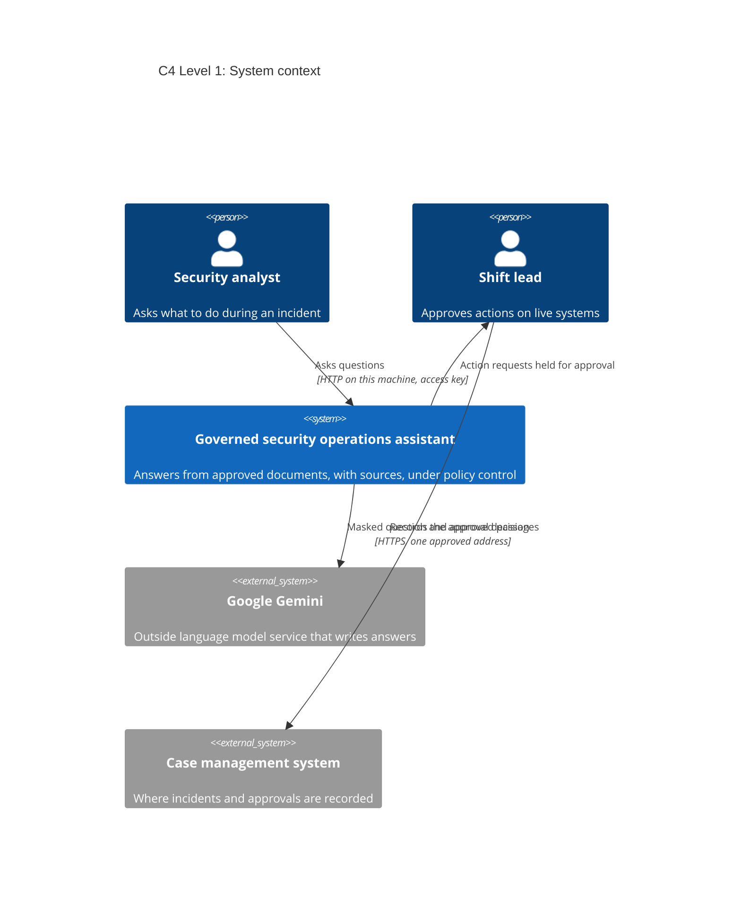
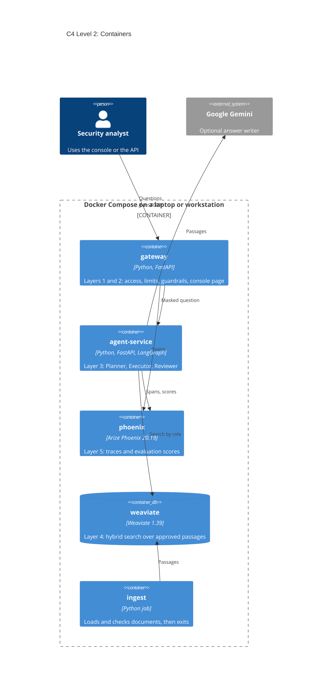
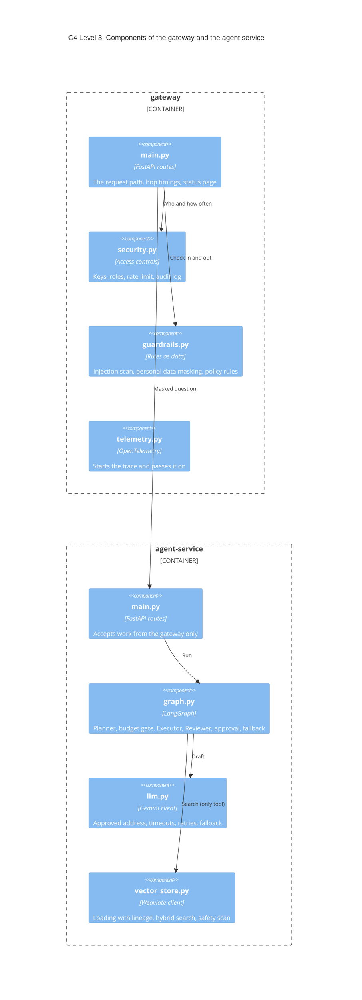
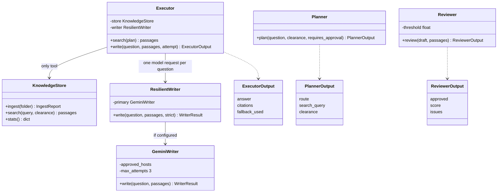
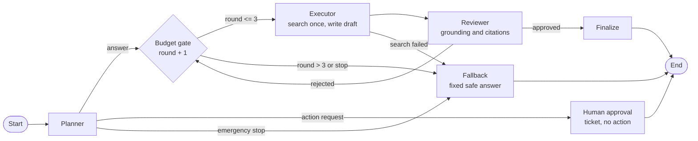
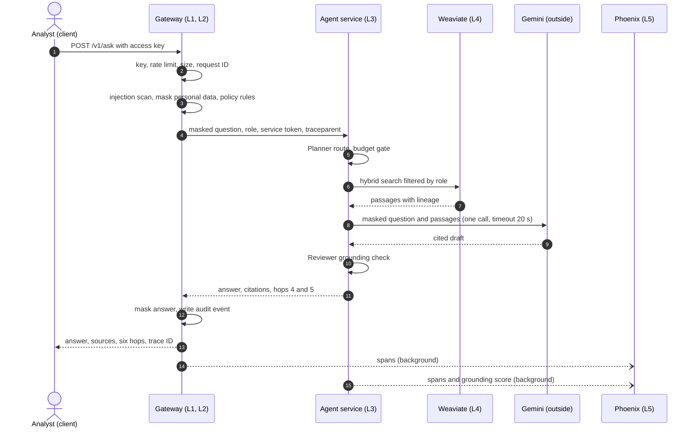

# Solution Design Document: Governed Security Operations Assistant

| Item | Detail |
|---|---|
| Document number | SDD-SECOPS-001 |
| Version | 1.0 |
| Status | Ready for security review |
| Date | 10 October 2026 |
| Document owner | Solution architect (forward deployed engineering) |
| Reviewers | Chief information security officer, enterprise architecture, security operations manager, privacy officer |
| Classification | Internal |

Section numbers are used as evidence references. For example "SDD 6.2" means section 6.2 of this document and the same reference appears in the running system's control plane console next to the layer it describes.

### Version history

| Version | Date | Change | Author role |
|---|---|---|---|
| 0.1 | 3 October 2026 | Discovery notes and draft architecture | Solution architect |
| 0.9 | 9 October 2026 | Threat model, control register and rollout plan added after build and testing | Solution architect |
| 1.0 | 10 October 2026 | Issued for security review with end-to-end evidence | Solution architect |

### Sign-off

| Role | Decision | Date |
|---|---|---|
| Chief information security officer | | |
| Enterprise architecture | | |
| Security operations manager (product owner) | | |
| Privacy officer | | |

---

## Contents

1. [Executive summary](#1-executive-summary)
2. [Customer discovery and requirements](#2-customer-discovery-and-requirements)
3. [Solution overview and design decisions](#3-solution-overview-and-design-decisions)
4. [Data and knowledge sources](#4-data-and-knowledge-sources)
5. [C4 architecture diagrams](#5-c4-architecture-diagrams)
6. [The five production layers](#6-the-five-production-layers)
7. [Workflows and data flow](#7-workflows-and-data-flow)
8. [Security architecture and control register](#8-security-architecture-and-control-register)
9. [Threat model](#9-threat-model)
10. [Governance and compliance](#10-governance-and-compliance)
11. [Observability and evaluation](#11-observability-and-evaluation)
12. [Rollout and rollback plan](#12-rollout-and-rollback-plan)
13. [Operations and handover](#13-operations-and-handover)
14. [Portfolio coherence: how the four projects connect](#14-portfolio-coherence-how-the-four-projects-connect)
15. [Risks, limitations and next steps](#15-risks-limitations-and-next-steps)
16. [Evidence index](#16-evidence-index)
17. [Glossary](#17-glossary)

---

## 1. Executive summary

**The problem.** Security analysts handling an incident need the right first-response steps within minutes. Today the steps live in runbooks and policies spread across shared folders. Analysts search by hand, new analysts escalate questions that the documents already answer and responses vary from shift to shift. Most attempts to fix this with an AI assistant stall at the security review, because the prototype cannot show what it will do with sensitive data, how it is controlled or how anyone would know if it misbehaved.

**The solution.** A governed assistant that answers only from approved documents and shows its sources. Every question passes through five layers on one controlled path: an API gateway that checks who is asking, guardrails that block unsafe prompts and mask personal data, an agent team with a hard limit on its own work, a vector store that only returns documents the caller may read and telemetry that records every step. Any request to change a live system, such as disabling an account, is held for a person to approve. The agents never act on their own.

**Why it can pass a security review.** The design answers the three weekly incident themes in the capstone marking table: supply chain, rogue agent and injection or outage.

| Incident | What this platform does about it |
|---|---|
| Supply chain risk to the Week 1 delivery pipeline (NASA Space Gallery) | Every package is pinned and checked by fingerprint when installed; images are scanned; the build pipeline holds no secrets |
| Alibaba ROME agent that broke its limits | The agents stop after 3 rounds, can be stopped instantly, may use only a search tool and cannot reach the internet from the data network |
| Cloud outages and prompt injection | Every question and every document is scanned for hidden instructions; the model is called with timeouts and retries and the platform keeps answering from the documents if the model is down |

**Before and after (targets, to be confirmed during the pilot).**

| Measure | Before | Target after | How it is measured |
|---|---|---|---|
| Time for an analyst to find the right runbook steps | About 10 to 15 minutes of manual searching (discovery estimate) | Under 1 minute, with sources cited | Latency recorded in every answer, plus analyst survey |
| Live-system actions taken without a second person | Not tracked | Zero; every action request held for approval | Audit log events and approval tickets |
| First-response consistency between shifts | Varies by analyst | Same cited runbook steps for the same question | Monthly sample review by the security operations manager |
| Sensitive data sent to an outside service | Not controlled | Zero personal data items in model calls | Guardrail counters and trace review |

**Status.** The platform runs end to end on a laptop or workstation with one Docker Compose command. A check script proves the six-hop path in six scenarios and the same check runs automatically on every change pushed to GitHub. Eighteen of twenty-one security controls are in place; the remaining three are planned before production and listed in section 8.

---

## 2. Customer discovery and requirements

### 2.1 Who the users are

| Stakeholder | What they need | What success means to them |
|---|---|---|
| Security operations analysts (tier 1 and tier 2) | Fast, correct first-response steps during an incident | Answers in seconds that match the runbook, with the source shown |
| Security operations shift lead | Control over actions that change live systems | No action happens without approval; requests arrive with context |
| Security operations manager (product owner) | Consistent responses across shifts and less escalation | Fewer avoidable escalations; the same answer for the same question |
| Chief information security officer | Evidence that the assistant is safe and governed | Every control documented, tested and visible; full audit trail |
| Privacy officer | No personal data leaking to outside services or logs | Personal data masked before it leaves the gateway |
| Platform and operations teams | Something they can deploy, monitor and roll back | One command to start, health checks, traces and a one-line rollback |

### 2.2 The current workflow and the root cause

Discovery sessions showed the current workflow: an alert or a user report arrives, the analyst opens the shared folder, searches several documents, asks a colleague when unsure and then acts. The symptom stakeholders described was "analysts are slow". The root cause is different: the knowledge exists but is hard to reach under pressure and nothing checks that the steps taken match the runbook. A general chatbot would make this worse, because it would answer confidently from outside knowledge. The requirement is therefore an assistant that is **grounded** (answers only from approved documents), **governed** (controlled, logged and limited) and **humble** (says when the documents do not cover a question).

### 2.3 Requirements

**Functional requirements**

| ID | Requirement |
|---|---|
| FR-01 | Answer analyst questions from approved runbooks and policies, citing the source of every statement |
| FR-02 | Say clearly when the approved documents do not cover a question, instead of guessing |
| FR-03 | Hold any request to change a live system for human approval and take no action |
| FR-04 | Show only documents the caller's role is cleared to read |
| FR-05 | Return, with every answer, the path the request took and how long each step took |

**Non-functional requirements**

| ID | Requirement | Target |
|---|---|---|
| NFR-01 | Latency | 95% of answers within 8 seconds with the model; within 1 second without it |
| NFR-02 | Availability during a model outage | Answers continue, quoting the documents |
| NFR-03 | Traceability | One trace per request, covering every service it touched |
| NFR-04 | Cost control | At most one model request per question (with up to two retries when the service is busy); cost per request recorded |
| NFR-05 | Reproducibility | The whole platform starts with one command from a clean machine |
| NFR-06 | Security | Controls in section 8, threats in section 9 |

### 2.4 Assumptions and constraints

- The first release serves the security operations team only, inside the corporate network.
- Documents are approved by their owners before loading; the platform does not judge whether a policy is correct.
- A free-tier Gemini key is acceptable for the pilot. Production would use a paid, contracted service.
- The pilot runs on one machine. Kubernetes (Minikube) is used to rehearse the staged release.
- The budget and timeline do not allow a single sign-on integration in the first release (see C-19 in section 8).

---

## 3. Solution overview and design decisions

The platform is five containers working together, started by one Docker Compose file. A question enters through the gateway, is checked by the guardrails, is answered by the agent team using the vector store and is recorded by the telemetry layer. The design follows the principle of "why before how": each important choice is recorded below with the reason for it.

| ID | Decision | Why | Alternatives considered |
|---|---|---|---|
| D-01 | A single API gateway in front of everything | One place to check identity, limits and policy; the agents are never exposed directly | Letting clients call the agent service directly: rejected, no single control point |
| D-02 | LangGraph with plain Python workers (Planner, Executor, Reviewer), not CrewAI | The Week 2 graph pattern is kept, but each worker is plain code. Only the Executor calls the model, with one request per question (retried at most twice if the service is busy). This keeps latency, cost and the free-tier quota under control, keeps the install small and lets every rule be tested without a key. CrewAI's core install brings in more than 30 packages and each CrewAI worker would make its own model call | LangGraph plus CrewAI workers as in Week 2: rejected for this release on cost, latency and supply chain surface |
| D-03 | Deterministic Planner and Reviewer | Routing and review rules must behave the same way every time and be testable; only answer writing needs a language model | Model-based planning: rejected, harder to predict and test |
| D-04 | Weaviate with hybrid search (meaning plus keywords) | Carries over the Week 3 design; keyword search finds exact terms such as "ransomware", meaning search finds paraphrases | Meaning-only search: misses exact terms |
| D-05 | Embedding model built into the image | The vector store and loader run on a network with no internet; nothing is downloaded at run time | Downloading at start-up: breaks the "no internet" rule |
| D-06 | Gemini with a quoted-passage fallback | A capable writer when available and continued service during outages (the Week 3 lesson) | Model only: an outage would stop the service |
| D-07 | OpenTelemetry traces sent to Arize Phoenix | Open standard; the gateway passes the trace on so one request is one trace across services; Phoenix also stores evaluation scores, as in Week 3 | Log files only: no end-to-end view |
| D-08 | Docker Compose for build and staging, Minikube for staged release | Compose is the simplest reproducible way to run five services; Minikube rehearses rolling updates and canary releases as in Week 1 | Kubernetes only: heavier for daily development |
| D-09 | Access keys with roles for the first release | Simple and testable now; single sign-on is planned (C-19) | Single sign-on now: outside the pilot's time budget |

---

## 4. Data and knowledge sources

| Document | Owner | Classification | Who may read it | Passages loaded |
|---|---|---|---|---|
| Security operations first-response runbook | Security operations manager | Internal | Analysts | 12 |
| Security incident management policy | Chief information security officer | Internal | Analysts | 6 (one paragraph held back, see below) |
| Acceptable use of technology policy | Human resources and IT | Public (all staff) | Analysts and viewers | 13 |

**Data quality and lineage.** The loader rebuilds paragraphs and section headings from each file, splits them into passages of up to about 800 characters within a section and records, for every passage, the file name, section, classification, the file's SHA-256 fingerprint and the load time. This lineage shows exactly which version of which document an answer came from. A file not listed in the classification table is treated as internal, so a new document is never shown to viewers by accident.

**Unsafe content.** The incident management policy contains a deliberately planted test sentence that tries to make the model reveal its hidden instructions. The loader detects it and holds back that one paragraph, while the rest of the section stays searchable. The same check runs again on every search result (defence in depth).

**Personal data.** The knowledge base contains no personal data. Questions may contain it (for example a colleague's email address), so the gateway masks personal data before the question goes any further (C-07).

---

## 5. C4 architecture diagrams

The C4 model describes a system at four levels of zoom: context (the system and the people and systems around it), containers (the separately running parts), components (the main building blocks inside a container) and code. The diagrams below are written in Mermaid, so GitHub draws them directly from this file. An executive one-page view is in `docs/architecture.pdf` and a plain-language workflow is in section 7.

### 5.1 Level 1: System context



### 5.2 Level 2: Containers



Connections: the analyst reaches the gateway over HTTP on port 8000, bound to this machine only, with an access key (TLS at the entry point is planned, C-20). The gateway calls the agent service over HTTP with the internal service token and the trace header. The agent service searches Weaviate over gRPC and HTTP on the data network and calls Gemini over HTTPS. Both services send spans to Phoenix using the OpenTelemetry protocol over HTTP.

Networks: the `edge` network joins the gateway, the agent service and Phoenix. The `data` network joins the agent service, the ingest job and Weaviate and is marked internal, so nothing on it can reach the internet. Only ports 8000 (console and API) and 6006 (Phoenix) are published and only to the host machine.

### 5.3 Level 3: Components



### 5.4 Level 4: Code (agent team)

The main classes of the agent team and how they relate. Each worker's reply must match a strict Pydantic schema before the next step uses it.



---

## 6. The five production layers

Each layer lists its purpose, the controls in scope, the owning team, the evidence reference and how its runtime state is checked. The same information appears live in the control plane console (Architecture view).

### 6.1 Layer 1: Experience (API gateway)

| Item | Detail |
|---|---|
| Purpose | The single front door for people and scripts. Every request is identified, limited and given a request ID and a trace ID before anything else happens |
| Components | `gateway/main.py`, `gateway/security.py`, `gateway/static/console.html` |
| Controls in scope | C-01 access keys checked in constant time and stored only as fingerprints; C-02 role-based document access; C-03 rate limit of 20 requests per minute per caller; C-04 question size limit of 1,000 characters; C-05 request ID and trace ID on every answer; C-16 service token to the agent service |
| Owning team | Platform engineering |
| Runtime state | Docker health check on `/health`; console status card |
| Evidence | `tests/test_gateway.py` (access, rate limit, size limit, hops); `evidence/e2e_report.md` scenario 1 |

### 6.2 Layer 2: Guardrails

| Item | Detail |
|---|---|
| Purpose | Policy enforcement on every question going in and every answer going out |
| Components | `gateway/guardrails.py` |
| Controls in scope | C-06 prompt injection scan; C-07 personal data and secrets masked in both directions; C-08 requests for credentials refused (rule POL-02); C-09 actions on live systems held for human approval (rule POL-01) |
| Owning team | Security engineering |
| Runtime state | A self-test runs on every status check and must block a known attack and mask a known email address |
| Evidence | `tests/test_gateway.py` (guardrail tests); `evidence/e2e_report.md` scenarios 2, 3 and 4 |

### 6.3 Layer 3: Agentic logic (agent team)

| Item | Detail |
|---|---|
| Purpose | Turns a checked question into a cited, reviewed answer, or holds it for approval |
| Components | `agent_service/graph.py`, `agent_service/llm.py`, `agent_service/main.py` |
| Controls in scope | C-10 hard cap of 3 rounds plus an emergency stop switch (`AGENTS_KILL_SWITCH`) and a 25-step limit inside LangGraph; C-11 knowledge search is the only tool; C-12 grounding review before release; C-13 model calls to one approved address with a 20-second timeout, up to 3 attempts and a quoted-passage fallback |
| Owning team | AI engineering |
| Runtime state | Health check on `/health` reports model mode, round cap and the emergency stop |
| Evidence | `tests/test_agents.py` (round cap, emergency stop, approval, fallback, retries); Phoenix trace |

The graph keeps the Week 2 pattern:



### 6.4 Layer 4: Vector RAG (vector store)

| Item | Detail |
|---|---|
| Purpose | Finds the approved passages that answer a question, limited to what the caller may read |
| Components | Weaviate 1.39 container; `agent_service/vector_store.py` |
| Controls in scope | C-14 unsafe document text held back at loading and at search time; C-15 vector store on a network with no internet access; C-02 classification filter applied inside the search |
| Owning team | Data platform |
| Runtime state | Weaviate readiness check; agent `/ready` reports whether passages are loaded |
| Evidence | `tests/test_agents.py` (planted sentence held back, viewer filter); `evidence/e2e_report.md` scenario 5 |

### 6.5 Layer 5: Telemetry

| Item | Detail |
|---|---|
| Purpose | Makes every request visible end to end and keeps an audit trail |
| Components | Arize Phoenix 20.19 container; `gateway/telemetry.py`; `agent_service/telemetry.py` |
| Controls in scope | C-17 one trace per request across both services, a grounding score stored as an evaluation and an audit log that never contains question text |
| Owning team | Site reliability and operations |
| Runtime state | Phoenix `/healthz`; console status card |
| Evidence | `evidence/e2e_report.md` scenario 6; Phoenix screenshot in `evidence/` |

---

## 7. Workflows and data flow

### 7.1 The workflow in plain language

1. An analyst types a question into the control plane console. *(a person)*
2. The gateway checks the access key, the caller's limit and the question size, then gives the request an ID. *(automatic)*
3. The guardrails block prompt injection and requests for credentials, mask personal data and mark action requests. *(automatic)*
4. If the question asks for an action on a live system, it is held as an approval ticket for the shift lead and the analyst is told that nothing has been done. *(a person decides)*
5. Otherwise the Planner routes it and the Executor searches the approved documents once and writes a cited draft. The Reviewer then checks that the draft is supported by the passages. *(automatic, at most 3 rounds)*
6. The answer goes back with its sources and the six hops. The analyst decides what to do with it. *(a person decides)*
7. Every step is recorded in Phoenix and in the audit log. Each week security engineering reviews blocked questions, ungrounded drafts and approval tickets. *(automatic, then a person reviews)*

The same workflow is drawn in `docs/request-workflow.drawio` (editable in draw.io), with lanes showing which steps a person owns and which are automatic:


### 7.2 Data flow for one request



### 7.3 Trust boundaries

| Boundary | What crosses it | Protection |
|---|---|---|
| Analyst to gateway | Question, access key | Key check, rate and size limits, guardrails |
| Gateway to agent service | Masked question, role | Service token, internal network only, trace header |
| Agent service to Weaviate | Search query, role filter | Data network with no internet, role filter inside the query |
| Agent service to Gemini | Masked question, approved passages | One approved address, HTTPS, key in a header (never in the address), timeouts |
| Services to Phoenix | Spans with masked text | Host-only port; question text masked before it is recorded |

---

## 8. Security architecture and control register

**Identity and access.** People use access keys mapped to roles: analysts read internal and public documents, viewers read public documents only. The gateway stores only the SHA-256 fingerprint of each key and compares fingerprints in constant time. The agent service trusts only requests carrying the internal service token. It decides document clearance from the role itself instead of trusting a list sent by the caller.

**Secrets.** All secrets live in the `.env` file, which is never committed. The services refuse to start if a secret is missing, still a placeholder or shorter than 16 characters. The Gemini key is sent in a request header, never in a web address, so it cannot leak into logs.

**Network.** Only the gateway (8000) and Phoenix (6006) publish ports and only to the host machine. Weaviate and the ingest job sit on an internal network with no internet route. In Kubernetes the same rules are written as network policies.

**Containers.** Images are built in two stages from a base image pinned by digest. They run as an ordinary user with all Linux capabilities dropped and privilege escalation blocked. The gateway's file system is read-only. Phoenix runs from a "distroless" image with no shell.

**Supply chain.** Every Python package is pinned with its fingerprints and installed with `--require-hashes`. Dependabot proposes updates to packages, base images and workflow actions. Each push builds the images, starts the whole platform, runs the end-to-end check and scans the images. The pipeline holds no secrets.

### Control register

| ID | Control | Layer | Status | Evidence |
|---|---|---|---|---|
| C-01 | Access keys checked in constant time and stored only as fingerprints | L1 | Pass | `test_keyring_returns_roles_and_never_stores_keys` |
| C-02 | Documents filtered by role (analyst or viewer) | L1, L4 | Pass | `test_viewer_only_sees_public_documents`; e2e scenario 5 |
| C-03 | Rate limit per caller | L1 | Pass | `test_rate_limit_returns_429` |
| C-04 | Question size limit of 1,000 characters | L1 | Pass | `test_overlong_question_is_rejected` |
| C-05 | Request ID and trace ID returned with every answer | L1 | Pass | `test_normal_request_shows_all_six_hops_in_order` |
| C-06 | Prompt injection scan on every question | L2 | Pass | `test_injection_attempts_are_blocked`; e2e scenario 2 |
| C-07 | Personal data and secrets masked in questions and answers | L2 | Pass | `test_personal_data_and_secrets_are_masked`; e2e scenario 3 |
| C-08 | Requests for credentials refused | L2 | Pass | `test_requests_for_credentials_are_refused` |
| C-09 | Actions on live systems held for human approval | L2, L3 | Pass | `test_action_request_goes_to_a_person_and_nothing_is_searched`; e2e scenario 4 |
| C-10 | Hard cap of 3 rounds and an emergency stop switch | L3 | Pass | `test_round_cap_stops_after_three_rounds`; `test_emergency_stop_halts_before_any_work` |
| C-11 | Knowledge search is the only tool the agents may use | L3 | Pass | `agent_service/graph.py` (Executor) |
| C-12 | Grounding review before any answer is released | L3 | Pass | `test_made_up_model_answer_is_rejected_then_replaced_by_quoted_passages` |
| C-13 | Model calls to one approved address, with timeouts, retries and fallback | L3 | Pass | `test_model_address_must_be_on_the_approved_list`; `test_gemini_outage_falls_back_to_quoted_passages` |
| C-14 | Unsafe document text held back at loading and at search time | L4 | Pass | `test_planted_instruction_in_the_policy_pdf_is_held_back` |
| C-15 | Vector store on a network with no internet access | L4 | Pass | `docker-compose.yml` (`data` network, `internal: true`) |
| C-16 | Secret service token between gateway and agent service | L1, L3 | Pass | `test_agent_service_only_accepts_the_gateway` |
| C-17 | One trace per request across services, plus an audit log without question text | L5 | Pass | e2e scenario 6; `gateway/security.py` (AuditLog) |
| C-18 | Hash-checked packages, non-root images and an image scan on every push | DevOps | Pass | `*/requirements.txt`; `*/dockerfile`; `.github/workflows/ci.yml` |
| C-19 | Single sign-on with multi-factor authentication for people | L1 | Review | Planned before production; access keys used in this release |
| C-20 | Encryption between containers | All | Review | Private container networks today; TLS at the entry point and between services planned |
| C-21 | Login for the Phoenix dashboard | L5 | Review | Host-only today; enable Phoenix authentication before shared use |

---

## 9. Threat model

The threat model starts from the three weekly incident themes in the capstone marking table (Weeks 1 to 3), then covers the OWASP Top 10 web application risks (2021 edition, A01 to A10) and the OWASP Top 10 for large language model applications (2025 edition, LLM01 to LLM10). Likelihood and impact are rated High, Medium or Low after the controls are applied (residual risk).

### 9.1 The three weekly incident themes mapped to this platform

| Incident (week) | What went wrong | How it could happen here | Controls | Test or evidence | Residual risk |
|---|---|---|---|---|---|
| Supply chain risk to the delivery pipeline (Week 1, NASA Space Gallery) | No incident was studied in Week 1. Its pipeline installed packages by version only and the base image by tag, so a tampered package or image would have been built and deployed unnoticed | A tampered Python package or base image enters an image build | C-18: exact versions and fingerprints with `--require-hashes`; base image pinned by digest; Dependabot; image scan; no secrets in the pipeline | `gateway/requirements.txt`, `agent_service/requirements.txt`, both `dockerfile`s, `ci.yml` | Low |
| Alibaba ROME autonomous agent (Week 2) | An agent with loose limits looped, escaped network controls and misused computing resources | The agent team loops, calls tools it should not or reaches outside networks | C-10 round cap and emergency stop; C-11 search is the only tool; C-09 actions need a person; C-15 no internet on the data network; containers with no added privileges | `test_round_cap_stops_after_three_rounds`, `test_emergency_stop_halts_before_any_work`, `test_action_request_goes_to_a_person_and_nothing_is_searched` | Low |
| Cloud outages and OWASP LLM01 prompt injection (Week 3) | Services depended on one unmonitored outside model; instructions hidden in documents hijacked retrieval | Gemini is down or slow; a question or document carries hidden instructions | C-13 timeouts, 3 attempts, quoted-passage fallback; C-06 question scan; C-14 document scan at loading and search; C-17 tracing of latency and cost | `test_gemini_outage_falls_back_to_quoted_passages`, `test_injection_attempts_are_blocked`, `test_planted_instruction_in_the_policy_pdf_is_held_back` | Medium (new injection wording can evade fixed patterns; see 15) |

Week 1 built the delivery pipeline for the NASA Space Gallery: Git, Docker, a Jenkins pipeline (checkout, build, test and deploy) and a Kubernetes rolling update on Minikube. No incident was studied that week. The capstone marking table names supply chain as the Week 1 theme, so this threat model treats that pipeline as the asset to protect. The capstone adds what the Week 1 pipeline did not have: fingerprint-checked installs, a digest-pinned base image, an image scan on every change, update alerts and a pipeline that holds no secrets.

### 9.2 Threat register

| ID | Threat | Source incident | OWASP | Controls | Test or evidence | Residual |
|---|---|---|---|---|---|---|
| T-01 | Tampered package or base image enters a build | Week 1 | A06, A08, LLM03 | C-18 | Lock files, digests, `ci.yml` | Low |
| T-02 | A compromised pipeline tool steals secrets | Week 1 | A08 | No secrets in CI; read-only workflow permissions | `ci.yml` | Low |
| T-03 | Secrets leak through the repository, images or logs | Week 1 | A02, A05 | `.env` ignored; weak keys refused; key fingerprints only; key in header | `.gitignore`, `test_keyring_returns_roles_and_never_stores_keys` | Low |
| T-04 | Agent loops without limit and burns resources | Week 2 | A04, LLM10 | C-10; one search per question; LangGraph step limit | `test_round_cap_stops_after_three_rounds`, `test_search_runs_once_per_question_even_over_several_rounds` | Low |
| T-05 | Agent takes a harmful action on a live system | Week 2 | LLM06 | C-09, C-11 | `test_action_request_goes_to_a_person_and_nothing_is_searched` | Low |
| T-06 | Agent or loader reaches the internet or an unintended host | Week 2 | A10, LLM06 | C-13 approved address list; C-15 internal network; network policies | `test_model_address_must_be_on_the_approved_list` | Low |
| T-07 | Operators cannot stop misbehaving agents quickly | Week 2 | LLM06 | Emergency stop switch | `test_emergency_stop_halts_before_any_work` | Low |
| T-08 | Direct prompt injection or system prompt extraction | Week 3 | A03, LLM01, LLM07 | C-06 | `test_injection_attempts_are_blocked`; e2e scenario 2 | Medium |
| T-09 | Indirect injection hidden in a document | Week 3 | LLM01, LLM04, LLM08 | C-14 | `test_planted_instruction_in_the_policy_pdf_is_held_back` | Medium |
| T-10 | Model service outage or slowdown | Week 3 | Availability | C-13 | `test_gemini_outage_falls_back_to_quoted_passages` | Low |
| T-11 | The model makes up an answer | Week 3 | LLM09 | C-12; answer only from passages; "not in documents" reply | `test_made_up_model_answer_is_rejected_then_replaced_by_quoted_passages` | Medium |
| T-12 | Personal or sensitive data disclosed in answers, traces or logs | | A02, A09, LLM02 | C-07; audit log without question text; masked text in traces | `test_answer_is_masked_on_the_way_out`; e2e scenario 3 | Low |
| T-13 | A viewer reads internal documents | | A01, LLM08 | C-02 applied inside the search, decided by the agent service | `test_viewer_only_sees_public_documents`; e2e scenario 5 | Low |
| T-14 | Stolen or guessed access key | | A07 | C-01, C-03; single sign-on planned (C-19) | `test_rate_limit_returns_429` | Medium |
| T-15 | Flood of requests or cost blow-out | | A04, LLM10 | C-03, C-04; one model request per question | `test_rate_limit_returns_429` | Low |
| T-16 | Not enough evidence to investigate an incident | | A09 | C-17; log rotation; retention policy (section 10) | e2e scenario 6 | Low |
| T-17 | Something other than the gateway calls the agent service | | A01, A07 | C-16; internal placement; network policy | `test_agent_service_only_accepts_the_gateway` | Low |
| T-18 | Insecure defaults or exposed ports | | A05 | Host-only ports; weak keys refused; hardened containers; Phoenix login planned (C-21) | `docker-compose.yml` | Medium |
| T-19 | An insider adds a poisoned document | | LLM04 | Document approval before loading; lineage fingerprints; default classification internal; quarantine | `test_unknown_documents_default_to_internal` | Medium |

### 9.3 OWASP Top 10 (2021) coverage

This table follows the 2021 edition used in the course reading. The 2025 edition gives software supply chain failures a category of its own; the Week 1 controls in section 9.1 address it.

| Category | How it is addressed |
|---|---|
| A01 Broken access control | Roles enforced inside the search by the agent service; service token; host-only ports |
| A02 Cryptographic failures | Keys stored as SHA-256 fingerprints; key sent in a header over HTTPS to Gemini; TLS inside the platform planned (C-20) |
| A03 Injection | Prompt injection scan; Weaviate queries built by the client library, never by joining text; strict request schemas |
| A04 Insecure design | This threat model; trust boundaries; human approval; rate and size limits |
| A05 Security misconfiguration | Weak secrets refused; hardened containers; read-only gateway file system; no debug mode |
| A06 Vulnerable and outdated components | Pinned versions, Dependabot, image scan |
| A07 Identification and authentication failures | Constant-time key checks; rate limiting; single sign-on with multi-factor authentication planned |
| A08 Software and data integrity failures | Fingerprint-checked installs; digest-pinned base image; document fingerprints in lineage |
| A09 Security logging and monitoring failures | Audit log for every decision; one trace per request; log rotation |
| A10 Server-side request forgery | Model address allow-list; the platform never fetches addresses supplied by users |

---

## 10. Governance and compliance

### 10.1 Roles and accountability

| Activity | Security operations manager | Security engineering | AI engineering | Platform engineering | CISO | Privacy officer |
|---|---|---|---|---|---|---|
| Approve documents for the knowledge base | Accountable | Consulted | Informed | | Informed | Consulted |
| Change guardrail and policy rules | Consulted | Accountable | Responsible | | Informed | Consulted |
| Change agent behaviour or the model | Consulted | Consulted | Accountable | Informed | Informed | |
| Approve each release stage | Responsible | Consulted | Responsible | Responsible | Accountable | Informed |
| Review blocked and ungrounded items weekly | Informed | Accountable | Responsible | | Informed | |
| Respond to an incident involving the assistant | Responsible | Accountable | Responsible | Responsible | Informed | Consulted |

An AI risk review group (the CISO, the privacy officer, enterprise architecture and the product owner) approves this document, each release stage and any change to the model, the tool list or the policy rules.

### 10.2 Policies for use

- The assistant is advisory: analysts remain responsible for their actions and must follow the runbook.
- The assistant never performs actions; action requests become approval tickets.
- Users are told, in the console and in every answer, which documents the answer came from.
- Questions should not contain personal data; when they do, it is masked automatically.

### 10.3 Data governance

| Topic | Rule in this platform |
|---|---|
| Classification | Each document is public or internal; unknown files default to internal |
| Data quality | Documents are approved by their owners; the loader rebuilds sections and rejects unsafe paragraphs |
| Lineage | Every passage stores its file, section, fingerprint and load time |
| Minimisation | Personal data is masked before the agents, the model, the traces and the logs; the audit log stores only the length and fingerprint of a question |
| Retention | Container logs rotate at 3 files of 10 MB; traces are kept 30 days (set a Phoenix project retention policy before production); approval tickets follow the case management system's retention rules |

### 10.4 Alignment with frameworks

| Framework | How the design aligns |
|---|---|
| NIST AI Risk Management Framework | Govern: section 10 roles and review group. Map: sections 2 and 9. Measure: section 11 metrics and evaluations. Manage: sections 12 and 13 |
| EU AI Act | An internal advisory tool for security staff, expected to fall outside the high-risk categories; transparency (sources shown) and human oversight (approval tickets) are built in. Confirm the classification with legal counsel |
| Data protection law (for example GDPR or a national equivalent) | Data minimisation through masking; no personal data in the knowledge base; access limited by role |
| ISO/IEC 42001 and ISO/IEC 38507 | Roles, policies, risk assessment, monitoring and continual improvement are documented here and can feed an AI management system |

---

## 11. Observability and evaluation

The three measurements stakeholders check before production are latency, cost per request and tool call success rate. Business KPIs (section 1) are measured after production.

| Measurement | Where it is recorded | Target or alert |
|---|---|---|
| Latency per request and per hop | Every answer (`metrics.latency_ms`, hop timings); Phoenix spans | 95% under 8 seconds |
| Cost per request | Every answer (`metrics.cost_usd`, from token counts and configured prices) | Within budget; alert on a 50% rise week on week |
| Tool call success rate | Every answer (`metrics.tool_success_rate`) | Above 99% |
| Grounding score | Every answer; stored in Phoenix as the "grounding" evaluation on the Reviewer step | 90% of answers grounded |
| Fallback rate | Every answer (`metrics.fallback_used`) | Investigate above 10% when a model key is configured |
| Blocked and held requests | Audit log events; console Security posture view | Reviewed weekly |

**Tracing.** The gateway starts one OpenTelemetry trace per request and passes it to the agent service in the `traceparent` header. Phoenix shows the whole tree: gateway, access check, guardrails, agent service, Planner, budget gate, Executor, hybrid search, answer writer and Reviewer. Span kinds (GUARDRAIL, AGENT, RETRIEVER, LLM, EVALUATOR) let Phoenix display each step correctly. Health checks and the console's status calls are not traced, so Phoenix lists only real questions.

**Evaluation.** The Reviewer computes a grounding score for each answer, the share of answer sentences supported by the retrieved passages. The agent service stores it in Phoenix against the Reviewer span. This continues the retrieval relevance evaluation from the Week 3 project. A golden set of questions with expected sources is the next step (section 15).

---

## 12. Rollout and rollback plan

### 12.1 Stages

| Stage | Where | Traffic to the new version | Entry criteria | Exit criteria | Minimum time |
|---|---|---|---|---|---|
| 0. Build gate | GitHub pipeline | None | Change pushed | Unit tests pass; images build; end-to-end check passes; scan reviewed | Each push |
| 1. Staging | Docker Compose on one machine | 100% of test traffic | Stage 0 passed | `e2e_check.py` 6 of 6; no new high findings; sign-off by security engineering | 1 day |
| 2. Canary | Minikube (Kubernetes) | 10% | Stage 1 signed off; CISO approval recorded by email | No rollback trigger for 24 hours and at least 100 requests | 1 day |
| 3. Half | Minikube | 50% | Stage 2 clean | No rollback trigger for 48 hours | 2 days |
| 4. Full | Minikube | 100% by rolling update of the stable version | Stage 3 clean; product owner approval | Canary removed; previous version kept for 7 days | 7 days |

### 12.2 Rollback triggers

Roll back immediately when any of these happens during a stage:

| Trigger | Threshold | Source |
|---|---|---|
| Error rate | Above 2% of requests in any hour | Gateway audit log (`agent_unavailable`) and HTTP status codes |
| Slow answers | 95th percentile above 8 seconds for 15 minutes | Answer metrics; Phoenix latency |
| Ungrounded answers | Fewer than 90% grounded over the last 100 answers | Phoenix grounding evaluations |
| Guardrail bypass | Any confirmed case | Weekly review or incident report |
| Unapproved action | Any case | Audit log |

### 12.3 How to roll back

The gateway decides which version answers each request using `CANARY_PERCENT`. Setting it to 0 sends all traffic back to the stable version within seconds. A failing canary is also handled automatically: if the canary cannot answer, the gateway retries the same request on the stable version, so users never see the failure.

**Docker Compose (staging and rehearsal):**

```bash
# start the canary at 10%
#   in .env: AGENT_CANARY_URL=http://agent-service-canary:8001 and CANARY_PERCENT=10
docker compose --profile canary up -d
# roll back
#   in .env: CANARY_PERCENT=0
docker compose up -d gateway
docker compose --profile canary stop agent-service-canary
```

**Kubernetes on Minikube:**

```bash
kubectl -n secops scale deployment/agent-service-canary --replicas=1
kubectl -n secops set env deployment/gateway CANARY_PERCENT=10
# roll back
kubectl -n secops set env deployment/gateway CANARY_PERCENT=0
kubectl -n secops rollout undo deployment/agent-service
kubectl -n secops scale deployment/agent-service-canary --replicas=0
```

The stable agent service uses a rolling update that keeps the old copy serving until the new one is ready (`maxUnavailable: 0`) and keeps 5 earlier versions for `rollout undo`, as in the Week 1 project.

### 12.4 Communication and sign-off

Each stage change is proposed by email to the AI risk review group with the latest `e2e_check.py` report and the stage metrics. Approval is recorded by reply email, which gives a clear written record. After full rollout the product owner reviews the business KPIs at 30 and 90 days.

---

## 13. Operations and handover

| Task | How |
|---|---|
| Start and stop | `docker compose up -d --build`; `docker compose down` |
| Check health | `docker compose ps`; console Overview; `GET /v1/status` |
| Emergency stop for the agents | Set `AGENTS_KILL_SWITCH=true` in `.env`, then `docker compose up -d agent-service`; on Minikube `kubectl -n secops set env deployment/agent-service AGENTS_KILL_SWITCH=true` |
| Add or update a document | Owner approves; place it in `agent_service/knowledge/`; add its classification in `vector_store.py`; rebuild and rerun the ingest job, which reloads only when a fingerprint has changed (`--force` reloads regardless) |
| Rotate keys | Generate new values with `openssl rand -hex 24`; update `.env`; `docker compose up -d` |
| Investigate a request | Take the trace ID from the answer and search for it in Phoenix; match the request ID in the audit log |
| Back up | Weaviate data can be rebuilt from the documents; back up the Phoenix volume if traces must be kept |

**Knowledge transfer.** Handover consists of a walkthrough of this document, a live demonstration of the six scenarios in the console and a session on reading traces in Phoenix. Feedback from the pilot users is collected through a short survey after two weeks and fed into the next release.

---

## 14. Portfolio coherence: how the four projects connect

| Week | Project and repository | Incident | What it contributed | Where it lives in this platform | What the capstone added |
|---|---|---|---|---|---|
| 1 | Delivery pipeline, NASA Space Gallery ([nasa-space-gallery](https://github.com/mapanya/nasa-space-gallery)) | None studied; the marking table names supply chain as this week's theme | Containers, automated tests, Jenkins pipeline, Kubernetes rolling update on Minikube | `dockerfile`s, `tests/`, `k8s/minikube.yaml` | Fingerprint-checked installs, digest-pinned base images, image scan, Dependabot and a secret-free pipeline: the supply chain controls the Week 1 pipeline did not have |
| 2 | Guardrailed multi-agent system ([guardrailed-multi-agent-system](https://github.com/mapanya/guardrailed-multi-agent-system)) | Alibaba ROME autonomous agent | Planner, Executor, Reviewer graph; round counter capped at 3; emergency stop; strict schemas | `agent_service/graph.py` | Human approval for actions; a single allowed tool; one model request per question |
| 3 | Monitored RAG service ([monitored-rag-service](https://github.com/mapanya/monitored-rag-service)) | Cloud outages and prompt injection | Weaviate hybrid search; injection filter; Phoenix tracing and evaluation; the policy documents | `agent_service/vector_store.py`, `gateway/guardrails.py`, telemetry | Local Weaviate on a closed network; quarantine at loading time; one trace across services; quoted-passage fallback |
| 4 | This platform | Most AI pilots stall at security review | Gateway, policy rules, human approval, Docker Compose, this design document | Whole repository | Brings the three earlier answers together behind one controlled path |

---

## 15. Risks, limitations and next steps

| Risk or limitation | Effect | Next step |
|---|---|---|
| Injection detection uses fixed patterns | New wording may get through | Add a second, model-based classifier; run red-team tests each release |
| Access keys instead of single sign-on | Keys can be shared or stolen | Integrate single sign-on with multi-factor authentication at the gateway (C-19) |
| No encryption inside the container network | Traffic could be read by anyone on the host | TLS at the entry point and between services (C-20) |
| Phoenix has no login | Anyone on the host machine can read traces | Enable Phoenix authentication (C-21) |
| Rate limits are kept in the gateway's memory | Limits are per copy of the gateway | Shared store such as Redis when scaling out |
| Approval tickets are recorded in the audit log only | Approvers must look them up | Create tickets directly in the case management system |
| Quoted-passage answers are less fluent than model answers | Lower user satisfaction during outages | Accept for resilience; measure satisfaction in the pilot |
| Gemini free tier has usage limits and models are retired | Throttling or a model name stopping working | Contracted service for production; model name kept in configuration |
| The image scan reports but does not block; the scanner, the workflow actions and the Weaviate and Phoenix images are pinned by version rather than digest | A vulnerable image could be released; a re-tagged tool or image could run | Block on critical findings before production; pin the scanner, actions and third-party images by digest |
| The rehearsal canary differs only by configuration | It proves the mechanism, not a code change | Use the same process for the next real code release |

---

## 16. Evidence index

| Claim | Evidence |
|---|---|
| One command starts the five-layer platform | `docker-compose.yml`; `evidence/e2e_report.md` (containers section) |
| A request flows Client, API gateway, Guardrails, Agents, Vector store, Telemetry | `evidence/e2e_report.md` scenario 1; `evidence/control-plane.png` |
| The same request is one trace in Phoenix, with a grounding score | `evidence/e2e_report.md` scenario 6; `evidence/phoenix-trace.png` |
| Guardrails block injection, mask personal data and hold actions | `evidence/e2e_report.md` scenarios 2, 3 and 4; `tests/test_gateway.py` |
| Agents stop after 3 rounds and on the emergency stop | `tests/test_agents.py` |
| The platform keeps answering during a model outage | `test_gemini_outage_falls_back_to_quoted_passages` |
| The checks run on every change | `.github/workflows/ci.yml`; the GitHub Actions tab of the repository |
| Staged release and rollback are defined and rehearsed | Section 12; `k8s/minikube.yaml` |
| Canary release and rollback rehearsed in Docker Compose and on Minikube | `evidence/rollout-rehearsal.md` |

---

## 17. Glossary

| Term | Meaning in plain words |
|---|---|
| Agent | A piece of software that carries out one part of a task; here the Planner, Executor and Reviewer |
| Audit log | A record of every security decision, kept for investigation |
| Canary | A new version that first receives a small share of real requests, so problems affect few users |
| C4 model | A way of drawing a system at four levels of zoom: context, containers, components and code |
| Embedding | A list of numbers that represents the meaning of a piece of text |
| Grounded answer | An answer supported by the approved documents it cites |
| Guardrail | A rule that blocks or changes a request or answer to keep it safe |
| Hybrid search | Search that combines matching by meaning with matching by keywords |
| Prompt injection | Text that tries to make a language model ignore its rules |
| RAG (retrieval augmented generation) | Answering a question by first finding relevant passages and then writing an answer from them |
| Span and trace | A span is one timed step; a trace is all the steps of one request |
| Vector store | A database that finds passages with similar meaning |
